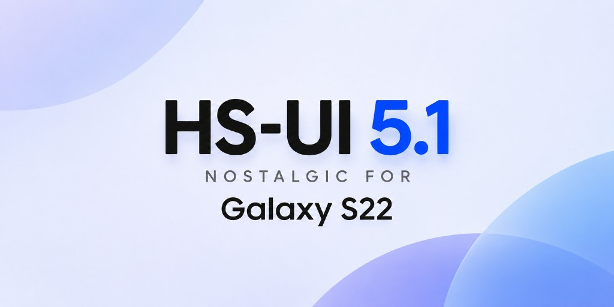

# HS-UI 5.1

Один универсальный архив One UI 5.1 для SM-S901E (r0q, XXV) с уже прошитым загрузчиком binary C (`S901EXXSCEYB1`). BL и CP не шьются и не скачиваются.

Система, vendor, product, system_ext и odm берутся из One UI 5.1 `S901EXXS7CWI1`. boot, dtbo, vendor_boot и модули `vendor_dlkm` берутся из One UI 6.1 `S901EXXSCEYB1`. Свежий XXV `S901EXXSEGZH4` (binary G) эта сборка не качает и в основу его ставить нельзя: бит загрузчика выше C.

## Основа

Перед HS-UI телефон должен стоять на One UI 6.1 binary C, сборка `S901EXXSCEYB1`, регион XXV.

Страница прошивки на SamFW: [SM-S901E XXV S901EXXSCEYB1](https://samfw.com/firmware/SM-S901E/XXV/S901EXXSCEYB1).

В Odin кладутся четыре файла этой сборки: BL, AP, CP и HOME_CSC. HOME_CSC сохраняет данные. Обычный CSC стирает данные. Re-Partition выключен. Прошивки с битом выше C не подходят.

Если в сведениях о ПО уже указан `S901EXXSCEYB1`, основу заново шить не нужно.

## Рекавери

Файлы лежат в `recovery/`.

- `OrangeFox-R12.0_A12-Unofficial-r0q.img.tar` ставится через Odin. Это tar из `OrangeFox-R12.0_A12-Unofficial-r0q.zip`. Сам zip больше 100 МБ, GitHub такой файл в репозиторий не принимает.
- `patched-vb.tar` содержит `vbmeta.img` с флагами `00 00 00 03`.

Порядок:

1. Включи OEM-разблокировку в параметрах разработчика и перезагрузись в Download Mode. На выключенном телефоне зажми обе кнопки громкости и подключи кабель, затем подтверди кнопкой громкости вверх.
2. Открой Odin. Auto Reboot выключи. Re-Partition выключи.
3. В AP положи `OrangeFox-R12.0_A12-Unofficial-r0q.img.tar`.
4. В USERDATA положи `patched-vb.tar`.
5. Нажми Start и дождись PASS.
6. Не дай телефону загрузиться в систему. Зажми громкость вниз и питание, пока экран не погаснет, и сразу зажми громкость вверх и питание, чтобы открыть OrangeFox. Если загрузится обычная система, стоковый рекавери вернётся на место и шаг придётся повторить.

Дальше в OrangeFox шьётся внутренний zip HS-UI. BL и CP этой прошивки не трогай.

## Что прошивать

Actions, workflow Build. Скачанный файл является zip-обёрткой. Распакуй её на компьютере и в рекавери прошивай внутренний `OneUI51_S901E_XXV_hybrid.zip`. Внутри него есть `META-INF`. Саму обёртку рекавери не примет.

Архив шьётся поверх текущей системы. Данные не форматируются. BL и CP не прошивай.

`/data` в этом архиве не шифруется. Из `/vendor/etc/fstab.qcom` и из копии в `vendor_boot` убран `keydirectory`. Format Data не нужен. Если раньше система уже создала ключ в `/metadata/vold/metadata_encryption`, удали этот каталог до первой загрузки, иначе старый ключ не совпадёт с разделом.

## Что остаётся

Звонки, SMS, камера, галерея, клавиатура Samsung, DeX, Мои файлы, Routines, Reminder, местоположение, экстренные вызовы, Find My Mobile, Samsung Account, Play Маркет, службы Google и Wi-Fi Calling.

Bluetooth-патч для One UI 5.1 лежит отдельным файлом `system/lib64/libbluetooth_jni.so`. Подписанный `com.android.btservices.apex` не переписывается.

## Что вырезано в универсальном архиве

Список UN1CA для r0q, плюс Knox и телеметрия.

- Chrome, Gmail, Карты, YouTube, Google Messages, Duo, OneDrive, Facebook-службы, Game Launcher
- Samsung Pass, каркас оплаты, Auth Framework, Digital Key, Car Key
- заводские тесты, SIM-unlock, Defex, скрипт восстановления рекавери
- dexpreopt: каталоги `oat`, `vdex`, профили boot image
- Rubin, Smart Suggestions, Story Service, Mate Agent, BBC Agent, DA Agent, Device Quality Agent, IMS Logger, Hiya
- Knox Guard, KnoxCore, Knox Analytics, KPE, MDM и связанные Knox-приложения
- автоустановка партнёрских приложений из Play (`PlayAutoInstallConfig`)

eSIM и `fabric_crypto` остаются: в UN1CA для r0q они тоже остаются. OMC и SDM не удаляются, от них зависят регион и настройки оператора.

## Дополнительный деблоат

`recovery/extra_samsung_S901E.zip` не входит в универсальный архив. Его прошивают отдельно те, кому не нужны личные приложения Samsung.

В OrangeFox смонтируй System и прошей этот zip. В логе будет строка `extra samsung` и число удалённых папок. Уже отсутствующие папки пропускаются, поэтому его можно ставить и до универсального архива, и после.

Удаляет:

- Bixby, Bixby Wakeup, Bixby Vision, настройки Bixby, Vision Intelligence, голосовой ввод, Finder
- Game Tools, Game Optimizing Service
- AR Zone, AR Emoji, редактор, AR Drawing, стикеры, аватар-стикеры, Dress Room
- Samsung Free, Galaxy Store, темы, Samsung Billing
- Kids Home, заглушку Galaxy Wearable, словарь, GpuWatch
- Smart Switch и его агенты
- SwiftKey (раздел `prism`, если он смонтирован)
- Samsung Cloud, Digital Wellbeing, Link to Windows, Your Phone
- обновлённые копии этих пакетов в `/data/app`

Не трогает звонилку, сообщения Samsung, камеру, Samsung Account, Wi-Fi Calling, OMC и SDM.

## Шифрование

`recovery/encryption_S901E.zip` включает шифрование `/data`. Он возвращает в `/vendor/etc/fstab.qcom` стоковую опцию `keydirectory=/metadata/vold/metadata_encryption`.

В OrangeFox смонтируй Vendor и прошей его. В логе должно быть `encryption on`.

Универсальный архив после этого снова снимет шифрование, если прошить его позже. На телефон с уже заполненным открытым `/data` этот zip не ставь: следующая загрузка начнёт шифрование, данные пропадут из рекавери, а старый ключ в `/metadata/vold/metadata_encryption` может увести телефон обратно в рекавери.

## Сборка

Один workflow, без выбора режима. Actions, Build, Run workflow.

FUS на запрос `CWI1` и `CEYB1` отдаёт более новые сборки того же бита. Actions берёт эти два AP из релиза [firmware-v1](https://github.com/homestuck-ng/hs-ui/releases/tag/firmware-v1). BL и CP в релиз не входят. Если релиза нет, скрипт спрашивает FUS и останавливается, когда PDA не совпал.
